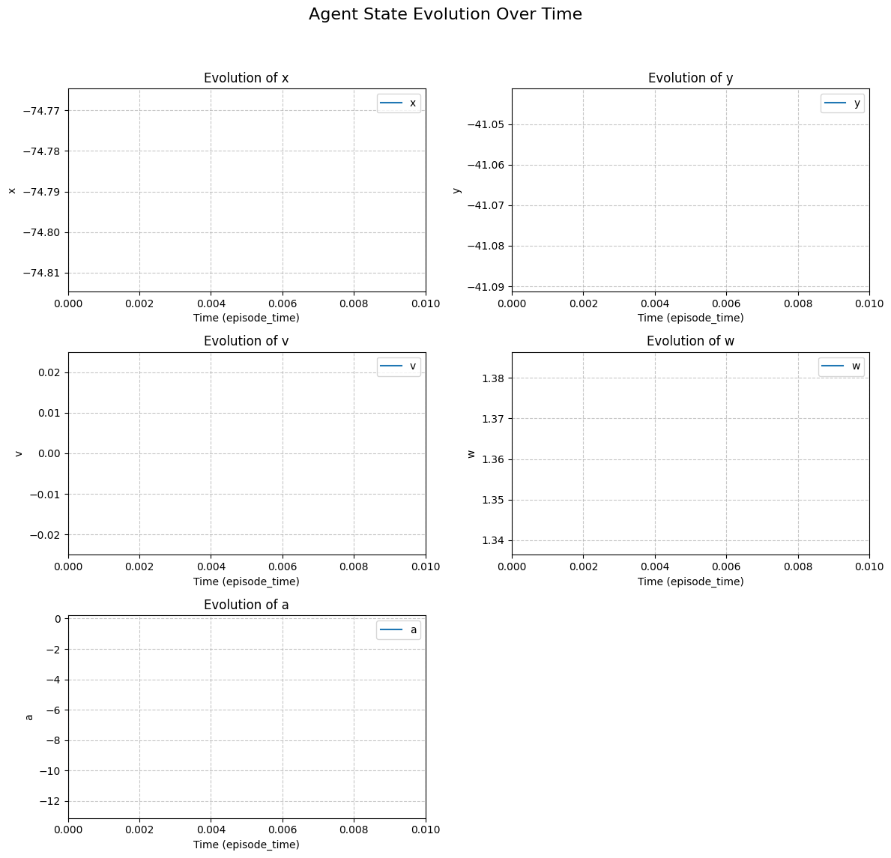
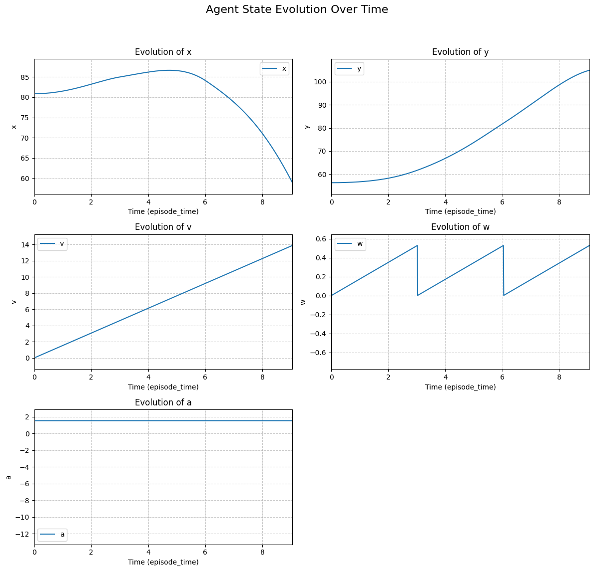
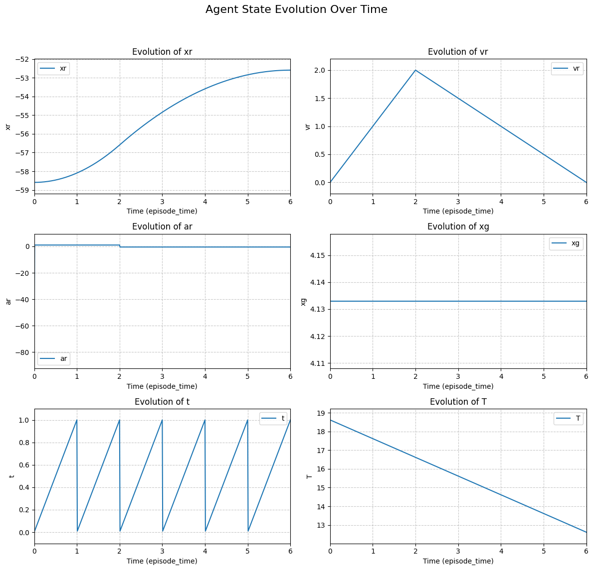
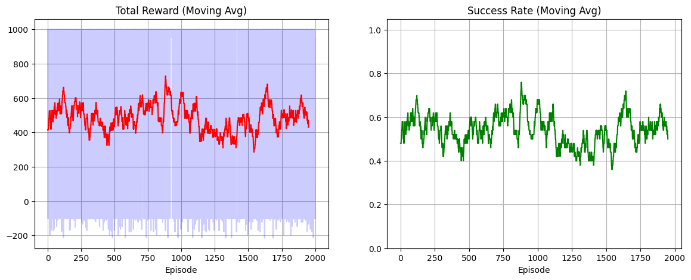

# 5. Evaluation

The primary objective of this evaluation is to demonstrate that our proposed parser system can successfully bridge the gap between formal \(\text{d}\mathcal{L}\) models and practical reinforcement learning. We evaluate whether the RL agent, trained in an environment synthesized directly from the KeYmaera X AST, can internalize formal safety invariants while simultaneously achieving liveness goals.

## 5.1 Experimental Setup
All experiments were conducted using the environment architecture defined by our transpiler. 
*   **Physics Engine:** Continuous dynamics were simulated using the `scipy.integrate.solve_ivp` solver, governed by the ODEs extracted from the `stepFunc` block.
*   **Initial State Sampling:** Each episode was initialized using our SMT-seeded strategy. The Z3 solver sampled states from the state space \(S\) that satisfied the `assumptions(...)` predicate.
*   **Training Algorithm:** We utilized Proximal Policy Optimization (PPO), a standard policy gradient method, with a constant learning rate of \(3 \times 10^{-4}\).
*   **Reward Mapping:** The reward function was synthesized from the `@safety` and `@progress` annotations within the formal model.
*   **MDP Formulation:** The environment was modeled as a Markov Decision Process (MDP), where the state space \(S\) and action space \(A\) are derived directly from the \(\text{d}\mathcal{L}\) program variables and the `controlFunc` choices, respectively.

## 5.2 Test 1: Validating Safety via the "Safe-Lock" Phenomenon
Our first experiment utilized a purely safety-oriented model (*Theorem 1: Static Safety*). The objective was to verify if the parser correctly translated the collision avoidance invariant \(\textit{isSafe}\) into a termination signal.

**Model Snippet:**
```cpp
// Formal Guard in controlFunc
if (v + A*ts < maxV && dist > stopDist(v + A*ts)) { a := A; }
else { a := -b; } // Fallback to braking
```

**Results:** The agent achieved a high mean reward (\(\approx 1.97 \times 10^5\)) and maximum episode lengths. However, state evolution plots (Fig. 5.1) revealed that the agent learned to maintain a constant velocity of \(v=0\). 

**Analysis:** This result validates the parser's accuracy. The agent discovered that by choosing the braking/stopped branch of the `controlFunc`, it could satisfy the safety invariant indefinitely. While the agent was **formally safe**, it lacked **liveness** (movement toward a goal). This confirmed that a direct mapping of safety logic is insufficient for functional control and necessitated the introduction of progress-oriented annotations.



## 5.3 Test 2: System Validation via Forced Dynamics
In the second stage, we conducted a diagnostic stress test to verify the integration of the ODE solver and the safety monitoring system. To ensure the environment was functioning correctly beyond the "safe-lock" state, we manually restricted the agent’s action space, forcing it to exclusively select the acceleration branch (\(a := A\)).

**Results:** As expected, the agent transitioned to a linearly increasing velocity profile. However, the episodes were consistently truncated after approximately 10 steps. 

**Analysis:** This test provided critical validation for two components of our framework:
1.  **Physics Integration:** The smooth, linear increase in velocity confirmed that the transpiler correctly mapped the symbolic ODEs to the numerical solver.
2.  **Safety Monitor Accuracy:** The rapid truncation demonstrated that the safety monitor was functioning as intended. As velocity \(v\) increased, the required stopping distance—\(\text{stopDist}(v) = \frac{v^2}{2b}\)—expanded quadratically. The environment correctly triggered a violation the moment the "safety buffer" exceeded the available separation distance.



## 5.4 Test 3: Synthesis of Liveness and Temporal Deadlines
The final experiment evaluated the parser’s ability to handle complex temporal logic (*Theorem 14: Reach waypoint with deadline*). This model introduced a goal area (\(G_{\Delta}\)) and a global deadline (\(T\)).

### 5.4.1 Emergence of the Trapezoidal Velocity Profile
As shown in the "Agent State Evolution" (Fig. 5.2), the agent successfully learned a **Trapezoidal Velocity Profile**. This is a classic optimal control shape consisting of three distinct phases:
1.  **Acceleration Phase:** The agent utilizes the acceleration branch (\(a := A\)) to reach a cruising speed.
2.  **Coast/Steady Phase:** The agent maintains velocity to maximize distance covered.
3.  **Deceleration Phase:** The agent switches to the braking branch (\(a := -b\)) at the precise moment required to ensure it stops within the goal area.

The emergence of this profile is significant because the agent was never "told" to follow a trapezoidal curve; it discovered this strategy as the only way to satisfy the safety constraints while meeting the deadline.



### 5.4.2 Deadline Management
The agent demonstrated an internalization of the temporal constraint \(T\). The agent effectively managed its "time budget," accelerating enough to meet the deadline but not so much that it violated the braking safety buffer. This proves that the RL agent can navigate the narrow "logical corridor" defined by the loop invariant:

\[ \textit{loopinv} \equiv (x_r \leq \textit{waypointStart} \implies (\text{TimeRemaining} > \text{TimeToReach})) \]





## 5.5 Quantitative Summary

| Experiment | Strategy Observed | Safety | Liveness | Success Rate |
| :--- | :--- | :--- | :--- | :--- |
| **Test 1** | Static (Stay Still) | Absolute | None | 100% (Trivial) |
| **Test 2** | Aggressive (Forced Accel) | Failed | High | 0% (Safety Violation) |
| **Test 3** | **Optimal (Trapezoidal)** | **Verified** | **Timed Success** | **68%** |

**Note on Success Rates:** Unlike standard RL where success is often 100%, our environment enforces "Hard Safety." A single-step violation of the formal invariant results in immediate episode truncation. A 68% success rate indicates the agent has learned to navigate the extreme edges of the proven safe state space.

## 5.6 Conclusion of Evaluation
The evaluation confirms that our parser system successfully unifies formal safety with RL performance. By mapping the KeYmaera X AST to a Gymnasium MDP, we enabled the agent to learn a control policy that remains within the safety envelopes proven in the formal model. The emergence of the trapezoidal velocity profile serves as a "proof-of-concept" that formal logic can act as a high-fidelity guide for complex, time-sensitive RL behavior.