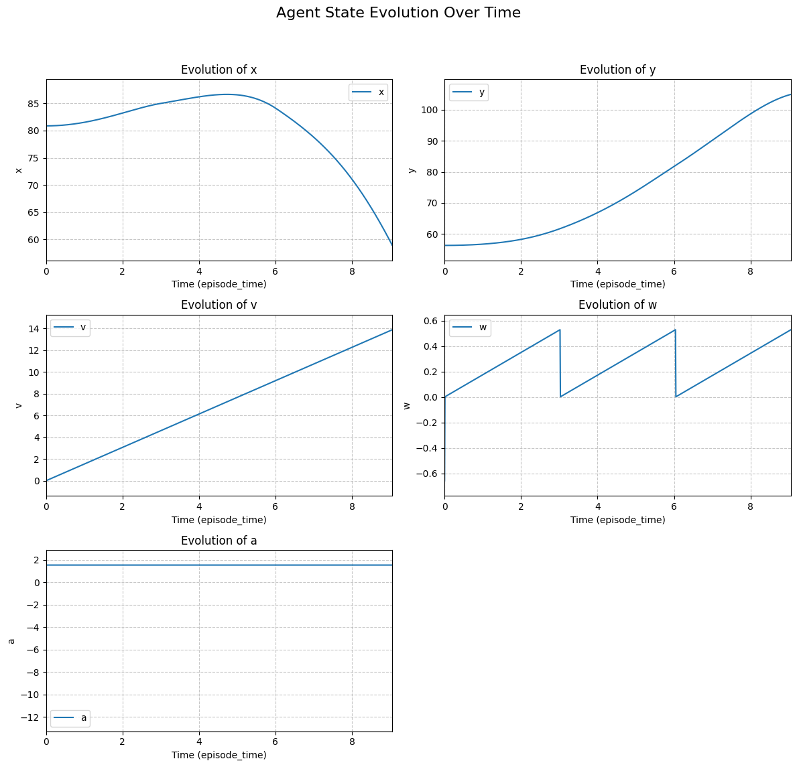

Starting training...
---------------------------------
| rollout/           |          |
|    ep_len_mean     | 10.3     |
|    ep_rew_mean     | 4.53e+03 |
| time/              |          |
|    fps             | 138      |
|    iterations      | 1        |
|    time_elapsed    | 14       |
|    total_timesteps | 2048     |
---------------------------------
-------------------------------------------
| rollout/                |               |
|    ep_len_mean          | 5.89          |
|    ep_rew_mean          | 2.34e+03      |
| time/                   |               |
|    fps                  | 133           |
|    iterations           | 2             |
|    time_elapsed         | 30            |
|    total_timesteps      | 4096          |
| train/                  |               |
|    approx_kl            | 0.00025844696 |
|    clip_fraction        | 0.000781      |
|    clip_range           | 0.2           |
|    entropy_loss         | -6.23         |
|    explained_variance   | 2.15e-05      |
|    learning_rate        | 0.0003        |
|    loss                 | 1.05e+07      |
|    n_updates            | 4900          |
|    policy_gradient_loss | -0.00283      |
|    std                  | 0.883         |
|    value_loss           | 2.01e+07      |
-------------------------------------------
-------------------------------------------
| rollout/                |               |
|    ep_len_mean          | 14.4          |
|    ep_rew_mean          | 6.6e+03       |
| time/                   |               |
|    fps                  | 149           |
|    iterations           | 3             |
|    time_elapsed         | 41            |
|    total_timesteps      | 6144          |
| train/                  |               |
|    approx_kl            | 2.5541813e-06 |
|    clip_fraction        | 0             |
|    clip_range           | 0.2           |
|    entropy_loss         | -6.23         |
|    explained_variance   | -0.013        |
|    learning_rate        | 0.0003        |
|    loss                 | 9.19e+06      |
|    n_updates            | 4910          |
|    policy_gradient_loss | -0.000167     |
|    std                  | 0.883         |
|    value_loss           | 1.67e+07      |
-------------------------------------------
------------------------------------------
| rollout/                |              |
|    ep_len_mean          | 10.6         |
|    ep_rew_mean          | 4.69e+03     |
| time/                   |              |
|    fps                  | 158          |
|    iterations           | 4            |
|    time_elapsed         | 51           |
|    total_timesteps      | 8192         |
| train/                  |              |
|    approx_kl            | 9.637675e-06 |
|    clip_fraction        | 0            |
|    clip_range           | 0.2          |
|    entropy_loss         | -6.23        |
|    explained_variance   | 0.000408     |
|    learning_rate        | 0.0003       |
|    loss                 | 1.54e+07     |
|    n_updates            | 4920         |
|    policy_gradient_loss | -0.000205    |
|    std                  | 0.883        |
|    value_loss           | 2.83e+07     |
------------------------------------------
-------------------------------------------
| rollout/                |               |
|    ep_len_mean          | 16.5          |
|    ep_rew_mean          | 7.68e+03      |
| time/                   |               |
|    fps                  | 166           |
|    iterations           | 5             |
|    time_elapsed         | 61            |
|    total_timesteps      | 10240         |
| train/                  |               |
|    approx_kl            | 1.1623371e-05 |
|    clip_fraction        | 0             |
|    clip_range           | 0.2           |
|    entropy_loss         | -6.23         |
|    explained_variance   | 0.0328        |
|    learning_rate        | 0.0003        |
|    loss                 | 1.15e+07      |
|    n_updates            | 4930          |
|    policy_gradient_loss | -0.000326     |
|    std                  | 0.883         |
|    value_loss           | 2.54e+07      |
-------------------------------------------
Training finished after 10000 timesteps. Model saved to ./ppo_kx_model\ppo_kx_agent.zip

Testing the trained agent for one episode:
Episode finished after 3 steps with reward: 900.0

test 1 formal model 

Theorem "IJRR17/Theorem 1: Static safety"

Definitions
  // Physical Constants
  // @const: bound=[0.1:0.5], def="time limit for control decisions"
  Real ep; 
  // @const: bound=[0.5:5.0], def="minimum braking capability of the robot"
  Real b;       
  // @const: bound=[1.0:10.0], def="maximum acceleration"
  Real A;       
  // @const: bound=[0.1:1.0], def="maximum steering (rotational velocity)"
  Real W;       

  // Distance Calculations
  Real stopDist(Real v) = v^2 / (2*b);
  Real accelComp(Real v) = ((A/b + 1) * (A/2 * ep^2 + ep*v));
  Real admissibleSeparation(Real v) = stopDist(v) + accelComp(v);

  // Directional Integrity:
  // Ensures the orientation vector (dx, dy) remains normalized.
  // @progress: reward=10, shape={-((dx**2 + dy**2) - 1)**2}, on_success=continue:status=none, on_failure=continue:status=none
  Bool isWellformedDir(Real dx, Real dy) <-> dx^2 + dy^2 = 1;

  // Physical Validity:
  // Prevents the agent from entering physically impossible states (negative velocity).
  // @safety: penalty=-500, on_failure=truncate:status=failure, on_success=continue:status=none
  Bool isPhysicallyValid(Real v, Real r) <-> (
    v >= 0 & r != 0
  );

  // Collision Avoidance (Core Safety):
  // The primary safety invariant. The shape encourages maximizing the gap
  // between current distance and required stopping distance.
  // @safety: penalty=-1000, shape={(abs(x-xo) - stopDist(v)) + (abs(y-yo) - stopDist(v))}, on_failure=truncate:status=failure, on_success=continue:status=none
  Bool isSafe(Real x, Real y, Real v, Real xo, Real yo) <-> (abs(x-xo) > stopDist(v) | abs(y-yo) > stopDist(v));

  // Velocity Efficiency:
  // Encourages the agent to maintain a productive velocity.
  // @progress: shape={1/v if v > 0 else v}, on_success=continue:status=none, on_failure=continue:status=none
  Bool isEfficient(Real v) <-> ( v >= 0 );

  // Global Bounds
  Bool bounds() <-> (
      A >= 0
    & b > 0
    & ep > 0
  );

  // Initial Conditions
  Bool initialState(Real x, Real y, Real v, Real dx, Real dy, Real xo, Real yo) <-> (
    v = 0
    & (x-xo)^2 + (y-yo)^2 > 0
    & isWellformedDir(dx, dy)
    & r != 0
  );

  Bool assumptions(Real x, Real y, Real v, Real dx, Real dy, Real xo, Real yo) <->
    bounds() & initialState(x, y, v, dx, dy, xo, yo);

  // Safety Invariant (Aggregate):
  // Combines sub-predicates for the formal proof.
  Bool loopinv(Real x, Real y, Real v, Real dx, Real dy, Real xo, Real yo, Real r) <-> (
    isPhysicallyValid(v, r)
    & isWellformedDir(dx, dy)
    & isSafe(x, y, v, xo, yo)
    & isEfficient(v)
  );

  // Goal Condition:
  // This predicate defines the goal of avoiding the obstacle.
  // If the condition is true (robot is not at the obstacle), it's a success and the episode terminates.
  // If the condition is false (robot is at the obstacle), it's a failure and the episode terminates.
  // @progress: reward=500, penalty=-1000, on_success=terminate:status=success, on_failure=terminate:status=failure
  Bool ensure(Real x, Real y, Real xo, Real yo) <-> (
    (x - xo)^2 + (y - yo)^2 > 0
  );

  // Control Logic
  HP controlFunc ::= {
      // Option 1: Brake on current curve or remain stopped
      { a := -b; }
      ++
      { ?v = 0; a := 0; w := 0; }
      ++
      // Option 2: Choose a new safe curve
      { a := A;
        w := *; ?-W<=w & w<=W;
        r := *;
        xo := *; yo := *;
        ?r!=0 & r*w = v;
        ? abs(x-xo) > admissibleSeparation(v)
        | abs(y-yo) > admissibleSeparation(v);
      }
    };;

    // Continuous Dynamics
    HP stepFunc ::= {
        x' = v * dx, y' = v * dy, v' = a,
        dx' = -w * dy, dy' = w * dx, w' = a/r,
        t' = 1 & t <= ep & v >= 0
      };
End.

ProgramVariables
  // @var: bound=[0:100], def="robot position: x"
  Real x;    
  // @var: bound=[0:100], def="robot position: y"
  Real y;    
  // @var: bound=[0:20], def="robot translational velocity"
  Real v;   
  // @var: bound=[-10:10], def="robot translational acceleration"
  Real a;    
  // @var: bound=[-1:1], def="robot orientation: x component"
  Real dx;   
  // @var: bound=[-1:1], def="robot orientation: y component"
  Real dy;   
  // @var: bound=[-2:2], def="robot rotational velocity"
  Real w;    
  // @var: bound=[-1000:1000], def="robot curve radius (r!=0)"
  Real r;    
  // @var: bound=[0:100], def="position of closest obstacle on curve: x"
  Real xo;  
  // @var: bound=[0:100], def="position of closest obstacle on curve: y"
  Real yo;   
  // @var: bound=[0:1], def="time elapsed in current control step"
  Real t;  
End.

Problem
assumptions(x, y, v, dx, dy, xo, yo) ->
  [
    {
      {
        controlFunc;
        t := 0;
      }

      // dynamics with local invariants
      {
      stepFunc;@invariant(t>=0, isWellformedDir(dx, dy))
      }
    }*@invariant(loopinv(x, y, v, dx, dy, xo, yo, r))
  ]ensure(x, y, xo, yo)
End.