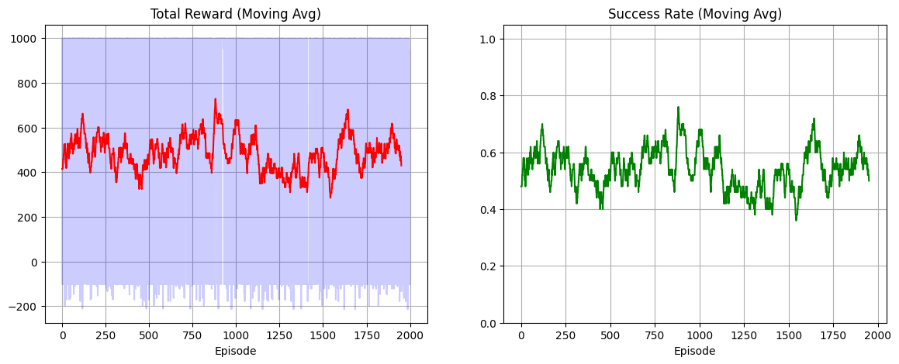
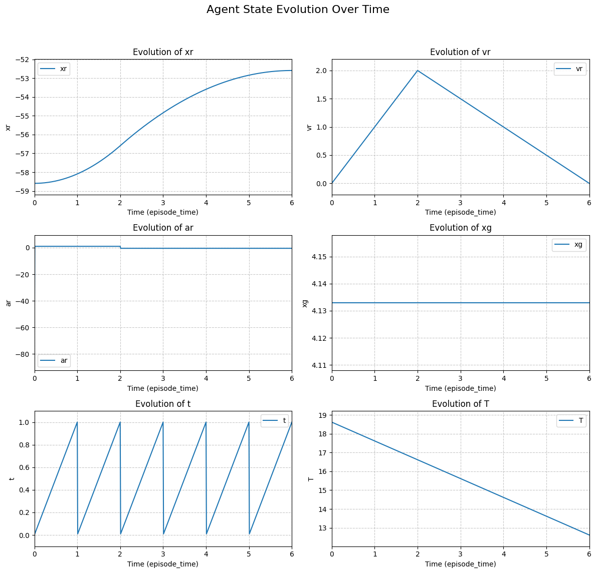

DEBUG_CISB: Expanding KeYmaera X expression for Z3 conversion: assumptions(xr, vr, xg, T)
DEBUG_CISB: Expanded KeYmaera X expression: ((((((A > 0) & (b > 0)) & (ep > 0)) & (Vmax >= ((2 * A) * ep))) & (GDelta > ((Vmax * ep) + ((Vmax ^ 2) / (2 * b))))) & (((vr = 0) & (xr < (xg - GDelta))) & (T > (((ep + (((xg - xr) - GDelta) / (A * ep))) + ep) + (Vmax / b)))))
Starting Training...
Ep   50 | Avg Rew:   414.4 | Success: 48.00% | LR: 2.00e-04
Ep  100 | Avg Rew:   550.8 | Success: 60.00% | LR: 2.00e-04
Ep  150 | Avg Rew:   551.7 | Success: 60.00% | LR: 2.00e-04
Ep  200 | Avg Rew:   441.1 | Success: 50.00% | LR: 2.00e-04
Ep  250 | Avg Rew:   578.5 | Success: 62.00% | LR: 2.00e-04
Ep  300 | Avg Rew:   527.7 | Success: 58.00% | LR: 1.81e-04
Ep  350 | Avg Rew:   443.2 | Success: 50.00% | LR: 1.81e-04
Ep  400 | Avg Rew:   486.3 | Success: 54.00% | LR: 1.81e-04
Ep  450 | Avg Rew:   459.2 | Success: 52.00% | LR: 1.81e-04
Ep  500 | Avg Rew:   388.4 | Success: 46.00% | LR: 1.63e-04
Ep  550 | Avg Rew:   457.3 | Success: 52.00% | LR: 1.63e-04
Ep  600 | Avg Rew:   527.1 | Success: 58.00% | LR: 1.63e-04
Ep  650 | Avg Rew:   463.7 | Success: 52.00% | LR: 1.63e-04
Ep  700 | Avg Rew:   440.8 | Success: 50.00% | LR: 1.63e-04
Ep  750 | Avg Rew:   548.9 | Success: 60.00% | LR: 1.45e-04
Ep  800 | Avg Rew:   569.3 | Success: 62.00% | LR: 1.45e-04
Ep  850 | Avg Rew:   614.4 | Success: 66.00% | LR: 1.45e-04
Ep  900 | Avg Rew:   438.6 | Success: 50.00% | LR: 1.45e-04
Ep  950 | Avg Rew:   641.6 | Success: 68.00% | LR: 1.45e-04
Ep 1000 | Avg Rew:   460.2 | Success: 52.00% | LR: 1.27e-04
Ep 1050 | Avg Rew:   632.9 | Success: 68.00% | LR: 1.27e-04
Ep 1100 | Avg Rew:   479.8 | Success: 54.00% | LR: 1.27e-04
Ep 1150 | Avg Rew:   570.2 | Success: 62.00% | LR: 1.27e-04
Ep 1200 | Avg Rew:   349.7 | Success: 42.00% | LR: 1.27e-04
Ep 1250 | Avg Rew:   438.3 | Success: 50.00% | LR: 1.10e-04
Ep 1300 | Avg Rew:   396.9 | Success: 46.00% | LR: 1.10e-04
Ep 1350 | Avg Rew:   374.6 | Success: 44.00% | LR: 1.10e-04
Ep 1400 | Avg Rew:   397.3 | Success: 46.00% | LR: 1.10e-04
Ep 1450 | Avg Rew:   354.2 | Success: 42.00% | LR: 1.10e-04
Ep 1500 | Avg Rew:   461.0 | Success: 52.00% | LR: 9.11e-05
Ep 1550 | Avg Rew:   487.6 | Success: 54.00% | LR: 9.11e-05
Ep 1600 | Avg Rew:   328.2 | Success: 40.00% | LR: 9.11e-05
Ep 1650 | Avg Rew:   571.5 | Success: 62.00% | LR: 9.11e-05
Ep 1700 | Avg Rew:   548.6 | Success: 60.00% | LR: 7.34e-05
Ep 1750 | Avg Rew:   481.3 | Success: 54.00% | LR: 7.34e-05
Ep 1800 | Avg Rew:   507.2 | Success: 56.00% | LR: 7.34e-05
Ep 1850 | Avg Rew:   487.7 | Success: 54.00% | LR: 7.34e-05
Ep 1900 | Avg Rew:   461.4 | Success: 52.00% | LR: 7.34e-05
Ep 1950 | Avg Rew:   594.0 | Success: 64.00% | LR: 5.47e-05
Ep 2000 | Avg Rew:   429.5 | Success: 50.00% | LR: 5.47e-05

test 4 formal model

Theorem "IJRR17/Theorem 14: Reach waypoint with deadline"

/*
 *	Robot must stop within distance delta at goal.
 *
 *  Robot
 * 	- must stop within distance delta of goal
 *  - can only drive straight and forward
 *  - ensures progress towards goal
 *
 *  Liveness property:
 *  - Robot can stop at goal
 *
 */

Definitions
    // @const: bound=[0.1:0.5]; def="time limit for control decisions"
    Real ep;      /* time limit for control decisions */
    // @const: bound=[0.5:5.0]; def="minimum braking capability of the robot"
    Real b;       /* minimum braking capability of the robot */
    // @const: bound=[1.0:10.0]; def="maximum acceleration"
    Real A;       /* maximum acceleration -b <= a <= A */
    // @const: bound=[1.0:10.0]; def="goal area size"
    Real GDelta;	 /* goal area size */
    // @const: bound=[5.0:30.0]; def="maximum robot velocity"
    Real Vmax;    /* robot cannot go faster than this */

    Real waypointStartDist(Real xg) = xg-GDelta;
    Real waypointEndDist(Real xg)   = xg+GDelta;

    Real minV = A*ep;
    Real maxTravelTime(Real g) = waypointStartDist(g)/minV;
    Real stopTime(Real v)      = v/b;
    Real speedUpTime(Real v)   = ep-v/A;

    Real stopDist(Real v) = v^2/(2*b);
    Real accComp(Real v)  = ( (A/b + 1)*(A/2*ep^2 + ep*v) );

    Bool bounds() <-> (                                                                  /* Bounds for global constants */
        A > 0                                                                                         /* Working engine */
        & b > 0                                                                                         /* Working brakes */
        & ep > 0                                                                              /* Controller reaction time */
        & Vmax >= 2*A*ep
        & GDelta > Vmax*ep + Vmax^2/(2*b)  /* waypoint is large enough that robot can start driving and still stop inside */
    );

    Bool initialState(Real xr, Real vr, Real xg, Real T) <-> (                      /* Stopped somewhere safe initially */
        vr = 0
        & xr < waypointStartDist(xg)
        & T > ep + maxTravelTime(xg-xr) + ep + stopTime(Vmax)
    );
    Bool assumptions(Real xr, Real vr, Real xg, Real T) <->              /* Under these assumptions we guarantee safety */
        bounds() & initialState(xr, vr, xg, T);

    // @safety: penalty=-1000, on_failure=truncate:status=failure
    Bool loopinv(Real xr, Real vr, Real xg, Real T) <-> ( // Added T to parameters as it's used in the invariant
        0 <= vr & vr <= Vmax & xr + stopDist(vr) < waypointEndDist(xg)
                & (waypointStartDist(xg) < xr -> (vr = 0 | T >= stopTime(vr)))
                & (xr <= waypointStartDist(xg) ->
                    (vr >= minV & T > maxTravelTime(xg-xr) + ep + stopTime(Vmax))
                    | (vr <= minV & T > speedUpTime(vr) + maxTravelTime(xg-xr) + ep + stopTime(Vmax)))
    );

    // Renamed 'ctrl' to 'controlFunc' as per documentation.
    // MODIFIED: Converted if/else structure to guarded choices (using '?' and '++')
    // and using curly braces {} for action grouping to be compatible with the parser.
    HP controlFunc ::= {
        // Choice 1: If in the goal area, decide to brake
        { ? (xr > waypointStartDist(xg));  ar := -b; } 
        ++
        // Choice 2: If in the goal area AND already stopped, decide to stay stopped
        { ? (xr > waypointStartDist(xg) & vr = 0);  ar := 0; }
        ++
        // Choice 3: If outside the goal area AND can accelerate, decide to accelerate
        { ? (xr <= waypointStartDist(xg) & (xr + stopDist(vr) + accComp(vr) < waypointEndDist(xg) & vr+A*ep <= Vmax));  ar := A; }
        ++
        // Choice 4: If outside the goal area AND cannot accelerate (must coast), decide to coast
        { ? (xr <= waypointStartDist(xg) & !(xr + stopDist(vr) + accComp(vr) < waypointEndDist(xg) & vr+A*ep <= Vmax));  ar := 0; }
    };

    // Renamed 'dyn' to 'stepFunc' as per documentation.
    HP stepFunc ::= {xr' = vr, vr' = ar, t' = 1, T'=-1 & t <= ep & vr >= 0};

    // The 'stepFunc;' was already wrapped in its own brace block in the previous iteration,
    // which aligns with the parser's expectation for the continuous part of the loop.
    HP dwwpdl ::= {
        {	{ controlFunc; t := 0; }
            { stepFunc; }
        }*@invariant(loopinv(xr, vr, xg, T))
    };

    // Define the 'ensure' predicate for the goal condition, with progress metadata.
    // This captures the liveness postcondition from the original problem statement,
    // which is typically the success condition for an RL agent.
    // The safety part of the original postcondition is handled in the Problem section.
    // @progress: reward=1000, on_success=terminate:status=success, on_failure=terminate:status=failure
    Bool ensure(Real xr, Real vr, Real xg) <-> (
        waypointStartDist(xg) < xr & vr = 0
    );

End.

ProgramVariables
    // @var: bound=[0:100], def="robot position: x"
    Real xr;
    // @var: bound=[0:20], def="robot translational velocity"
    Real vr;
    // @var: bound=[-10:10], def="robot translational acceleration"
    Real ar;
    // @var: bound=[0:100], def="goal position: x"
    Real xg;
    // @var: bound=[0:1], def="time elapsed in current control step"
    Real t;
    // @var: bound=[0:1000], def="global time remaining until deadline"
    Real T;
End.

Problem
    // The problem statement is adapted to use 'assumptions' and 'ensure'.
    // The original problem combined safety and liveness.
    // The first part is the safety property (what must always hold at the end).
    // The second part is the liveness property (that the 'ensure' goal is reachable).
    assumptions(xr, vr, xg, T)
        -> [ dwwpdl; ](xr < waypointEndDist(xg) & (T <= 0 -> ensure(xr, vr, xg))) // Safety postcondition
        & < dwwpdl; > ensure(xr, vr, xg)                                         // Liveness postcondition
End.

